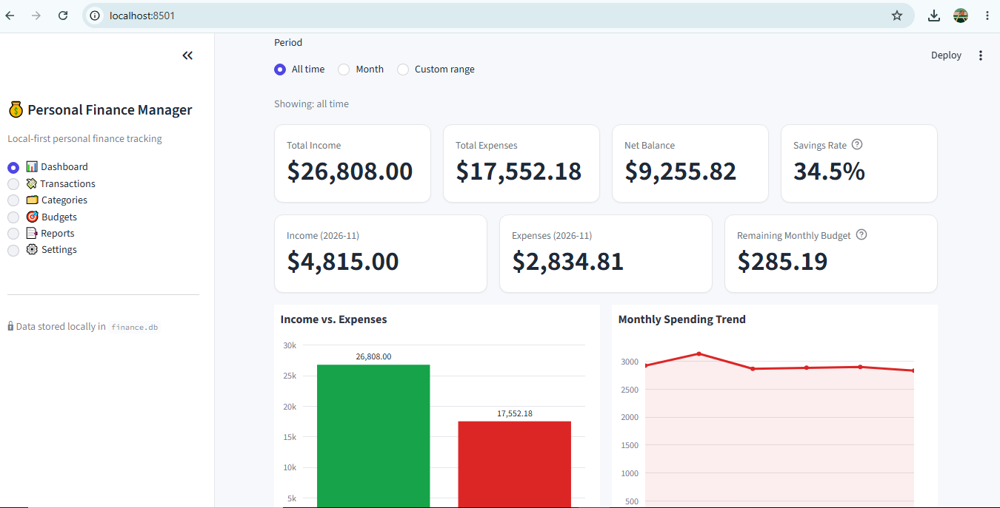
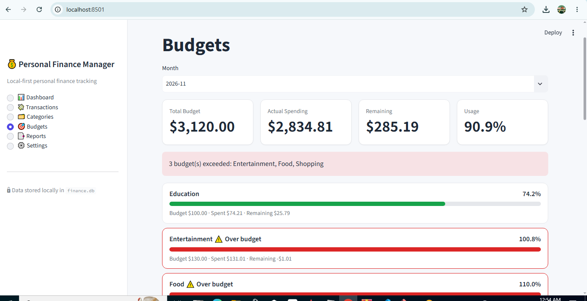
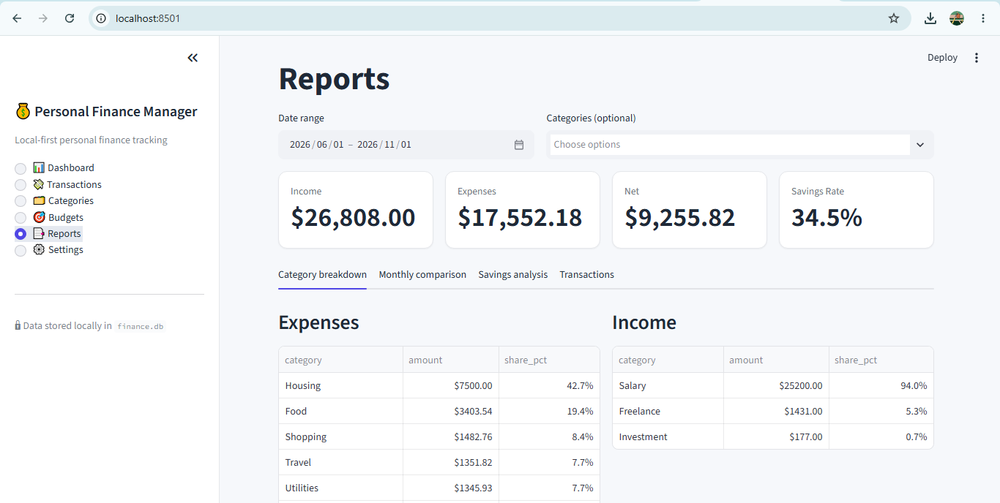

# Personal Finance Manager

A local-first personal finance dashboard built with Streamlit and SQLite. Track income and expenses, set monthly budgets, analyse spending and export reports to CSV or Excel. Your data stays on your machine, with no accounts, cloud services or paid APIs.

## Features

- **Dashboard**: total income and expenses, net balance, savings rate, current-month figures and remaining monthly budget, plus four interactive charts with all-time, month and custom-range filters.
- **Transactions**: add, edit, delete (with confirmation), search, filter by type, category and date range, and sort.
- **Categories**: default income and expense categories, custom categories, rename, and safe delete (categories in use must be reassigned first).
- **Budgets**: monthly budgets per expense category with actual spending, remaining amount, usage percentage, progress bars and highlighting of exceeded budgets.
- **Reports**: income and expense summaries, category breakdowns, month-over-month comparison, savings analysis, custom date ranges, CSV and Excel export.
- **Settings**: currency display (USD, EUR, GBP), light/dark preference, optional sample data, database backup and restore.

## Screenshots





## Technology stack

Python 3.11+, Streamlit, SQLite, SQLAlchemy 2.x, Pandas, Plotly, Openpyxl, Pytest.

## Project structure

```
personal-finance-manager/
├── app.py                  # Streamlit entry point
├── config.py               # Paths, currencies, default categories
├── database/               # SQLAlchemy models, engine, backup/restore
├── services/               # Business logic (transactions, categories, budgets,
│                           #   analytics, reports, settings, sample data)
├── components/             # Streamlit UI (sidebar, pages, charts)
├── utils/                  # Validators, exporters, formatting helpers
├── tests/                  # Pytest suite (temporary databases only)
├── data/                   # Local database (git-ignored)
└── screenshots/
```

Calculations (`services/analytics.py`, `services/reports.py`) and exporters are pure functions over DataFrames, which keeps them easy to test.

## Installation

```bash
python -m venv .venv
# Windows: .venv\Scripts\activate    macOS/Linux: source .venv/bin/activate
pip install -r requirements.txt
```

## Execution

```bash
streamlit run app.py
```

The database is created automatically on first launch. It starts empty (apart from the default categories); load sample data from **Settings** if you want to explore.

## Testing

```bash
pytest -q
```

Tests run against temporary databases and never touch `data/finance.db`.

## Database information

- Engine: SQLite via SQLAlchemy. Default location: `data/finance.db` (shown in **Settings**).
- Override with the `PFM_DB_PATH` environment variable.
- Tables: `categories`, `transactions`, `budgets`, `app_settings`.
- Amounts are stored as floating-point numbers rounded to two decimals. Currency selection changes display formatting only; no conversion is performed and currencies are never combined.

### Backup and restore

- **Backup**: Settings → *Download database backup* saves a consistent copy of the database.
- **Restore**: Settings → upload a `.db`, `.sqlite` or `.sqlite3` file, tick the confirmation box and click *Restore database*. The file is validated (SQLite header, integrity check, expected tables and columns) before anything is replaced, and your current database is copied to `data/backups/` first.

## Privacy

All data is stored locally and nothing is sent over the network. **The database is not encrypted.** Use your operating system's disk encryption and file permissions if you need to protect it. `data/` is git-ignored so personal records are not committed.

## Export functionality

Reports can be exported as CSV (transactions or monthly summary) or as an Excel workbook with Summary, Monthly, category and Transactions sheets. Exports use readable column names, ISO dates and numeric amounts, and respect the date range and category filters selected on the Reports page.

## Notes and limitations

- The light/dark preference styles the page, cards, inputs and charts. Tables are drawn by Streamlit itself and follow Streamlit's own theme (⋮ menu → Settings → Choose app theme).
- Single-user, local use. There is no authentication.

## Future improvements

Recurring transactions, CSV import, multi-currency accounts with explicit exchange rates, tags, savings goals, optional database encryption.

## License

MIT, see [LICENSE](LICENSE).
